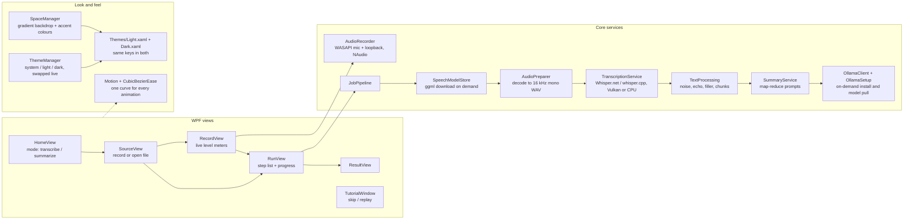

# Meet Simple (C# / .NET 8 / WPF)

Windows desktop app that records a meeting (microphone + computer audio, as separate tracks) or opens an existing
recording, transcribes it locally, and optionally writes a short summary locally. Nothing leaves the computer.

## Architecture

## Folder map
- `Core/` - no UI code. `JobPipeline` runs the steps and reports `StepUpdate`s; setup steps (speech model, Ollama, summary AI) run only when the chosen mode needs them.
- `Views/` - one UserControl per screen; `MainWindow` is the shell (custom chrome: sidebar + floating content card) and owns navigation (`Navigate`, `Show*`).
- `Theme.xaml` - colours, button/card styles. Use `AccentButton`, `QuietButton`, `LinkButton`, `DangerButton`, `CardBorder`, `PanelBorder`.
- `build.bat` - self-contained publish to `publish\` + zip for sharing. `installer.iss` - optional Inno Setup installer.

## Behaviour to preserve
- First launch shows `TutorialWindow`; "Skip tour" is always visible; "Quick tour" (sidebar) replays it. `AppSettings.TutorialCompleted` is set when it closes either way.
- Nothing large is downloaded without asking (`MainWindow.ConfirmSetupAsync`). If the summary engine fails to set up, the transcript is still delivered and the failure is shown on the result screen.
- Recorded tracks: "You" (microphone) and "Others" (computer audio). Echoes of "Others" on the mic track are dropped in `TextProcessing.MergeTracks`.
- WASAPI loopback sends no data during silence, so `TrackWriter` pads silence to keep both tracks aligned.

## Conventions
- Meaningful names only (no single-character variables). Long-running work stays off the UI thread; UI updates go through `Dispatcher`.
- Only `README.md` and this file are kept as .md documentation.

## Theming and motion
- `Themes/Light.xaml` and `Themes/Dark.xaml` hold only colour brushes and must define identical keys. `ThemeManager` swaps them at runtime (merged dictionary index 0). First launch follows the Windows light/dark setting (`Theme = "system"`), and it updates live if Windows changes while the app is open. Choosing Light/Dark in Settings or the sidebar sun/moon button saves an explicit choice.
- Always reference brushes with `{DynamicResource ...}` (never `StaticResource`), and from code use `SetResourceReference` - otherwise that element will not change when the theme does. Use `AccentTextBrush` for accent-coloured text (readable on dark), `AccentBrush` for fills and borders, `ErrorFillBrush` for red button backgrounds.
- Title bars follow the theme through `ThemeManager.Attach(window, brushKey)` (call it for every new window). MessageBox dialogs are native Windows and stay light.
- Every animation uses `CubicBezierEase` (cubic-bezier 0.65, 0, 0.35, 1: ease in, ease out): in XAML as `{StaticResource StandardEase}`, in code through `Theming/Motion.cs` (`FadeIn`, `RiseIn`, `FadeOut`, `Settle`, `AnimateValue`, `Capture`). Durations are 0.2-0.4 s for hover and press, about 0.4-0.6 s for screens and theme changes. Do not add instant colour or visibility jumps.
- Screen changes and theme changes cross-fade using a picture of the old state (`PageSnapshot`, `ThemeSnapshot` in MainWindow). When Windows animations are off (`Motion.Enabled` is false) everything changes instantly.
- Arc-inspired shell (`MainWindow.xaml`): no standard title bar (`WindowChrome`, 36 px drag strip, custom minimise/maximise/close). A gradient "space" backdrop (`SpaceBackdropBrush`) fills the window; the left sidebar draws straight on it (new-transcript pill, pinned tiles, Library rows, space dots, theme toggle) and all screens live in a rounded floating card on the right. When maximised, `RootGrid.Margin` is set to the resize border so nothing is cut off.
- Spaces (`Theming/SpaceManager.cs`): violet (default), ocean, forest, sunset, graphite. Each defines light and dark gradient colours plus accent colours. `SpaceManager` writes `SpaceBackdropBrush`, `AccentBrush`, `AccentTextBrush` and `AccentSoftBrush` into `Application.Resources`, which override the palette dictionary, so accents follow the space in both themes. The choice is saved as `AppSettings.Space`; changing it cross-fades through the same snapshot mechanism as the theme.
- Sidebar styles in `Theme.xaml`: `SidebarButton`, `SidebarNavButton` (RadioButton with selected fill), `SpaceDotButton`, `CaptionButton`/`CloseCaptionButton`, `GlyphText` (Segoe MDL2 Assets icons), `IconBadge`. Sidebar text uses the `Sidebar*Brush` keys because it sits on the backdrop, not on the card. Window content must fit at the 1000 px minimum width (card rows use `WrapPanel`).
- Cards are `ContentControl` with `CardBorder` (not Border). `LinkButton` shows its text twice for the hover fade, so its content must be plain text. Buttons use an overlay tint and a small press scale instead of swapping brushes, so they stay smooth in both themes.

## Security (read before changing network, process or file code)
- Threat model: local, single-user app. Audio, transcripts and summaries never leave the computer. Only runs with the user's rights (`app.manifest`: asInvoker).
- Network egress is exactly three things, each only after the user agrees in `ConfirmSetupAsync`: speech models from huggingface.co, the Ollama installer from ollama.com (redirects to GitHub), and summary models pulled by the local Ollama server. Ollama calls go to localhost only (`UseProxy=false`).
- `Downloader`: HTTPS only, host allowlist checked on every redirect hop (manual redirects, max 5), size caps, SHA-256 computed while streaming, file moved into place only after `verify` passes.
- Speech models: id must be in `Catalog.SpeechModels`; the download is rejected unless it matches Hugging Face's `X-Linked-Etag` SHA-256 (fail closed).
- Ollama: `AuthenticodeVerifier` must confirm a valid signature by "Ollama Inc." on the installer before it runs and on `ollama.exe` before `serve`. `FindExecutable` never searches PATH.
- Untrusted input: the settings file (size cap + `AppSettings.Sanitize`), model names and language codes (`InputValidation`), output file names (`InputValidation.SafeFileName`), regexes (2 s timeout), error text (`Redaction.Scrub` before display or copy).
- Do not: add telemetry, run a PATH-resolved program, follow redirects automatically, skip the checksum or signature checks, or relax the host allowlists without a reason.
- Supply chain: `packages.lock.json` is committed and CI restores with `--locked-mode`; Dependabot + CodeQL + a vulnerable-package check run in `.github/`. Releases: publish the zip's SHA-256 (`build.bat` prints it); code-signing the exe is recommended.
- Unverified: the Authenticode P/Invoke, the Ollama installer flags (`/SP- /VERYSILENT /SUPPRESSMSGBOXES /NORESTART`) and the signer name "Ollama Inc." have not been run on a real machine. If the signer check blocks a genuine install, check the certificate's subject before loosening it.

## Licensing
- This project is MIT (`LICENSE`). Dependencies (NAudio, Whisper.net, Whisper model weights) are believed to be MIT - verify on each package/repo page before a release; re-check when upgrading (e.g. NAudio 3 needs net9.0+).
- Models are downloaded at runtime and never bundled in releases or the installer. The default summary model (`llama3.1:8b`) is under Meta's Community License, which the user accepts when it is pulled; bundling it would make this project a redistributor. Keep `Catalog.SummaryModels` swappable (a permissively licensed model is an option).
- Documentation is `README.md` (public landing page) and this file. If a third-party notice is added later, list each dependency, its license, and what the app downloads.

## Build and share
- Needs the .NET 8 SDK on the build machine only. `build.bat` produces a self-contained folder: users install nothing.
- Unsigned exes show a Windows SmartScreen warning ("More info" > "Run anyway"). A code-signing certificate removes it.
- Not single-file on purpose: Whisper.net loads native runtimes from `runtimes\` next to the exe.

## Transcription accuracy
- Default speech model is `large-v3-turbo-q5_0` (`Catalog.DefaultSpeechModel`); older saved settings that still say `small` are upgraded once via `AppSettings.SettingsVersion`.
- `TranscriptionService.BuildProcessor` mirrors the faster-whisper CLI: beam search (size 5, patience 1) when `BestAccuracy` is on, temperature fallback (0, +0.2), entropy 2.4 / log-prob -1 / no-speech 0.6 thresholds.
- Optional glossary (`AppSettings.Glossary`, cleaned by `InputValidation.CleanGlossary`, max 400 chars) is passed as the Whisper prompt so names and jargon are spelled correctly.
- Loudness normalization was deliberately not added (Whisper's log-mel features are level-insensitive). Whisper.net 1.9.0 has no VAD builder method (only raw native fields), so VAD is not used.
- The transcript stays verbatim; `TextProcessing.CleanFiller` is applied only to summary input.

## Status / unverified
- Written without a compiler available; first `dotnet build` may report errors to fix. Package versions (NAudio 2.2.1, Whisper.net 1.9.0 + Runtime + Runtime.Vulkan) and the Whisper.net call shapes (`WhisperFactory.FromPath`, `CreateBuilder().WithLanguage(...)`, `ProcessAsync(Stream, token)`) are the first things to check.
- Light/dark switching, the system-theme detection, all animations and the Arc-style shell (custom `WindowChrome`, maximise margin, card clipping, space switching, sidebar styles) have not been run on a real machine yet (written and statically checked only).
- Not yet tested on a real machine: recording, Vulkan runtime selection, Ollama silent install flags (`/SILENT /NORESTART`).
- Whisper.net builder calls added for accuracy (`WithBeamSearchSamplingStrategy().WithBeamSize().WithPatience().ParentBuilder`, `WithPrompt`, `WithTemperature`, `WithTemperatureInc`, `WithEntropyThreshold`, `WithLogProbThreshold`, `WithNoSpeechThreshold`) exist in the 1.9.0 DLL by name, but argument types and return types are not compiled yet.
