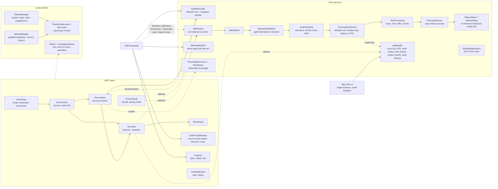

# Meet Simple (C# / .NET 8 / WPF)

Windows desktop app that records a meeting (microphone + computer audio, as separate tracks) or opens an existing
recording, transcribes it locally, and optionally writes a short summary locally. Nothing leaves the computer.

## Architecture



## Folder map
```
/
  README.md, LICENSE, CONTRIBUTING.md, SECURITY.md, AGENTS.md
  MeetSimple.sln, global.json
  .github/                 CI, CodeQL, Dependabot
  src/MeetSimple/          WPF app project (csproj, XAML, Core, Views, Theming, Themes, Fonts)
  build/                   build.bat, Trim-Publish.ps1, installer.iss
  publish/                 local output only (gitignored)
```
- `src/MeetSimple/Core/` - no UI code. `JobPipeline` runs the steps and reports `StepUpdate`s; setup steps (speech model, Ollama, summary AI) run only when the chosen mode needs them.
- `src/MeetSimple/Views/` - one UserControl per screen; `MainWindow` is the shell (custom chrome: sidebar + floating content card) and owns navigation (`Navigate`, `Show*`). `AppDialog` is the themed notice/confirm window.
- `src/MeetSimple/Fonts/` - embedded Inter TTFs (Regular, Medium, SemiBold, Bold) and Inter Display Bold, as WPF `Resource` (`Fonts\*.ttf`). `OFL.txt` ships next to the exe as `Licenses\Inter-OFL.txt` (required by the licence).
- `src/MeetSimple/Theme.xaml` - colours, fonts, button/card styles. Use `AccentButton`, `QuietButton`, `LinkButton`, `DangerButton`, `CardBorder`, `ChoiceCardButton` (keyboard-focusable Home/Source cards), `PanelBorder`, `DisplayTitle` (bold page/card titles).
- `build/build.bat` - self-contained single-file publish to repo-root `publish\` + zip for sharing. Force-closes running `MeetSimple.exe` first; calls `build/Trim-Publish.ps1` to drop unused Whisper RIDs and write `Read me.txt`. `build/installer.iss` - optional Inno Setup installer.

## Behaviour to preserve
- First launch shows `TutorialWindow`; "Skip tour" is always visible; "Quick tour" (sidebar) replays it. `AppSettings.TutorialCompleted` is set when it closes either way.
- Nothing large is downloaded without asking (`MainWindow.ConfirmSetupAsync`). If the summary engine fails to set up, the transcript is still delivered and the failure is shown on the result screen.
- Recorded tracks: "You" (microphone) and "Others" (computer audio). Echoes of "Others" on the mic track are dropped in `TextProcessing.MergeTracks`.
- WASAPI loopback sends no data during silence, so `TrackWriter` pads silence to keep both tracks aligned.

## Conventions
- **UI copy: less is more.** Never show the same fact twice on one surface (title vs detail vs progress ring). Say only what matters right now; drop text that restates a label, and leave a line out rather than fill it. Example: the island shows "Transcribing", the ring shows the percentage, and the hover line adds only "About 12 min left".
- Meaningful names only (no single-character variables). Long-running work stays off the UI thread; UI updates go through `Dispatcher`.
- Public docs at repo root: `README.md`, `CONTRIBUTING.md`, `SECURITY.md`, and this file.

## Theming and motion
- `Themes/Light.xaml` and `Themes/Dark.xaml` hold only colour brushes and must define identical keys. `ThemeManager` swaps them at runtime (merged dictionary index 0). First launch follows the Windows light/dark setting (`Theme = "system"`), and it updates live if Windows changes while the app is open. Choosing Light/Dark in Settings or the sidebar sun/moon button saves an explicit choice.
- Always reference brushes with `{DynamicResource ...}` (never `StaticResource`), and from code use `SetResourceReference` - otherwise that element will not change when the theme does. Use `AccentTextBrush` for accent-coloured text (readable on dark), `AccentBrush` for fills and borders, `ErrorFillBrush` for red button backgrounds.
- Title bars follow the theme through `ThemeManager.Attach(window, brushKey)` (call it for every new window). Prefer `AppDialog` (themed notice/confirm) for in-app prompts; keep native MessageBox only for unexpected fatal errors in `App.xaml.cs`.
- **Typography:** Inter for all UI text (`AppFont` = `pack://application:,,,/Fonts/#Inter`), Inter Display for titles (`AppDisplayFont`, used by `DisplayTitle`, Bold). Windows set `FontFamily="{StaticResource AppFont}"`. Do not add other typefaces; never bring back Apple's SF Pro (its licence forbids shipping it in a Windows app). Icon glyphs stay `Segoe MDL2 Assets` via `GlyphText` / explicit `FontFamily` — that system font is required for the symbol set and is not UI body text.
- **`AppDialog`:** borderless transparent window (`WindowStyle="None"`, `AllowsTransparency="True"`, `Background="Transparent"`) with a rounded `SurfaceBrush` card and soft `DropShadowEffect`. Do not put an opaque `Background` or `WindowChrome` CornerRadius on it — that draws a hard black rectangle around the rounded card. Source: `Views/AppDialog.xaml`.
- **Activity island (`Views/ActivityIsland`, `Theming/SpringEase`):** a running job keeps going while people look around. Leaving `RunView` shrinks a snapshot of the page into a near-black pill at the bottom of the card; clicking it grows back into `RunView` (or `ResultView` once done). Two spring-animated values drive everything: `Expansion` (0 pill, 1 whole card) and `Lift` (-1 hidden, 0 resting, 1 hover/announce); `Relayout` derives size, position, corner radius and content opacity, so overshoot reads as elastic. Appearing, shrinking from a page and growing back use `SpringEase`; hover and the end-of-job lift use the shared `CubicBezierEase`, slowly (0.7 s open, 0.56 s close, after a 90 ms hover-intent dwell), with the detail line fading in only in the last part of the opening and the shadow deepening. These are the only places `SpringEase` is used, on purpose. `Island*Brush` keys exist in both palettes. `MainWindow` keeps `Host.Margin` bottom clear (`IslandClearance`) while the pill shows.
- Every other animation uses `CubicBezierEase` (cubic-bezier 0.65, 0, 0.35, 1: ease in, ease out): in XAML as `{StaticResource StandardEase}`, in code through `Theming/Motion.cs` (`FadeIn`, `RiseIn`, `FadeOut`, `Settle`, `AnimateValue`, `Capture`). Durations are 0.2-0.4 s for hover and press, about 0.4-0.6 s for screens and theme changes. Do not add instant colour or visibility jumps.
- Screen changes and theme changes cross-fade using a picture of the old state (`PageSnapshot`, `ThemeSnapshot` in MainWindow). When Windows animations are off (`Motion.Enabled` is false) everything changes instantly.
- Arc-inspired shell (`MainWindow.xaml`): no standard title bar (`WindowChrome`, 36 px drag strip, custom minimise/maximise/close). A gradient "space" backdrop (`SpaceBackdropBrush`) fills the window; the left sidebar draws straight on it (new-transcript pill, pinned tiles, Library rows, space dots, theme toggle) and all screens live in a rounded floating card on the right. When maximised, `RootGrid.Margin` is set to the resize border so nothing is cut off. No privacy footnote in the rail — trust copy lives on Home. Library nav rows use roomy padding (`SidebarNavButton` / `SidebarButton` `10,11` plus small margins between Home / Settings / Quick tour).
- Wizard screens (Source / Record / Run / Result) show a `FlowStepStrip` (`Summarize · Record` style). Record Back returns to Source for the same mode, not Home.
- Spaces (`Theming/SpaceManager.cs`): violet (default), ocean, forest, sunset, graphite. Each defines light and dark gradient colours plus accent colours. `SpaceManager` writes `SpaceBackdropBrush`, `AccentBrush`, `AccentTextBrush` and `AccentSoftBrush` into `Application.Resources`, which override the palette dictionary, so accents follow the space in both themes. The choice is saved as `AppSettings.Space`; changing it cross-fades through the same snapshot mechanism as the theme. `SpaceChanged` fires after a space swap; sidebar and Settings rebuild space dots on theme/space change so dark-mode swatches stay correct.
- **Do not mutate Freezables after putting them in `Application.Resources`.** On .NET 8 WPF, assigning a brush to Resources freezes it (and its `GradientStop`s). `SpaceManager.Apply` must replace the whole frozen brush each time space or theme changes (`FrozenGradient` / `Frozen`); mutating shared static `GradientStop.Color` throws `InvalidOperationException` ("read-only state") at startup.
- Sidebar styles in `Theme.xaml`: `SidebarButton`, `SidebarNavButton` (RadioButton with selected fill), `SpaceDotButton`, `CaptionButton`/`CloseCaptionButton`, `GlyphText` (Segoe MDL2 Assets icons), `IconBadge`. Sidebar text uses the `Sidebar*Brush` keys because it sits on the backdrop, not on the card. Window content must fit at the 1000 px minimum width (card rows use `WrapPanel`).
- **Level meters (`Views/LevelMeter`):** slim rounded bars drawn in `OnRender` on every frame (`CompositionTarget.Rendering`, only while visible and attached). Input is the highest peak since the last frame (`AudioRecorder.TakeMicrophonePeak`), mapped to a dB scale (-54 dBFS floor, curve 1.4, so hiss barely shows and speech fills most of the bar). Fast attack (12 ms) and slow release (650 ms) keep it from jittering. Accent gradient that brightens toward the leading edge with a faint halo; a small peak dot holds 0.8 s then falls with acceleration. A vintage VU-style face was tried and rejected; keep the slim bar. Do not go back to `ProgressBar` for levels.
- Mode/source pickers use `ChoiceCardButton` (real `Button`, keyboard focusable). Decorative/non-click panels stay `CardBorder` / `PanelBorder`. `LinkButton` shows its text twice for the hover fade, so its content must be plain text. Buttons use an overlay tint and a small press scale instead of swapping brushes, so they stay smooth in both themes.

## Security (read before changing network, process or file code)
- Threat model: local, single-user app. Audio, transcripts and summaries never leave the computer. Only runs with the user's rights (`app.manifest`: asInvoker).
- Call detection reads only which apps hold the microphone (audio sessions + Windows privacy records), never audio, and records only after the user clicks Record. Registry writes: the optional HKCU Run value, and the notification library's per-user app registration (HKCU AppUserModelId / COM activator for notification clicks).
- Network egress is four things: (1–3) only after the user agrees in `ConfirmSetupAsync` — speech models from huggingface.co, the Ollama installer from ollama.com (redirects to GitHub), and summary models pulled by the local Ollama server (localhost only, `UseProxy=false`); (4) optional **update check / apply** when Settings “Check for updates” is on — metadata from `api.github.com`, then the release zip (+ `.sha256`) from GitHub asset hosts via `Downloader` (fail closed on checksum). Never auto-install without the Update button.
- `Downloader`: HTTPS only, host allowlist checked on every redirect hop (manual redirects, max 5), size caps, SHA-256 computed while streaming, file moved into place only after `verify` passes.
- **App updates:** `UpdateChecker` + `AppUpdater`. Compare assembly `<Version>` to `/releases/latest`. On Update: verify SHA-256 (prefer `MeetSimple-win-x64.zip.sha256`, else hex in release body), zip-slip-safe extract, `apply.cmd` replaces files after exit and relaunches. Bump `<Version>` in the csproj to match the GitHub tag **before** `build\build.bat`; upload the `.sha256` file with the zip.
- Speech models: id must be in `Catalog.SpeechModels`; the download is rejected unless it matches Hugging Face's `X-Linked-Etag` SHA-256 (fail closed).
- Ollama: `AuthenticodeVerifier` must confirm a valid signature by "Ollama Inc." on the installer before it runs and on `ollama.exe` before `serve`. `FindExecutable` never searches PATH.
- Untrusted input: the settings file (size cap + `AppSettings.Sanitize`), model names and language codes (`InputValidation`), output file names (`InputValidation.SafeFileName`), regexes (2 s timeout), error text (`Redaction.Scrub` before display or copy).
- Do not: add telemetry, run a PATH-resolved program, follow redirects automatically, skip the checksum or signature checks, or relax the host allowlists without a reason.
- Supply chain: `packages.lock.json` is committed and CI restores with `--locked-mode` on .NET 8; Dependabot + CodeQL + a vulnerable-package check run in `.github/`. `Microsoft.NET.ILLink.Tasks` 8.0.33 is an explicit PackageReference so locked restore matches both `dotnet build` and single-file `dotnet publish`. Releases: bump `<Version>` to the tag, run `build.bat` (prints SHA-256 and writes `MeetSimple-win-x64.zip.sha256`), upload both assets; code-signing the exe is recommended.
- Unverified: the Authenticode P/Invoke, the Ollama installer flags (`/SP- /VERYSILENT /SUPPRESSMSGBOXES /NORESTART`) and the signer name "Ollama Inc." have not been run on a real machine. If the signer check blocks a genuine install, check the certificate's subject before loosening it.

## Licensing
- This project is MIT (`LICENSE`). Dependencies (NAudio, Whisper.net, Whisper model weights) are believed to be MIT - verify on each package/repo page before a release; re-check when upgrading (e.g. NAudio 3 needs net9.0+).
- Models are downloaded at runtime and never bundled in releases or the installer. The default summary model (`llama3.1:8b`) is under Meta's Community License, which the user accepts when it is pulled; bundling it would make this project a redistributor. Keep `Catalog.SummaryModels` swappable (a permissively licensed model is an option).
- **Fonts:** Inter 4.1 (SIL Open Font License 1.1, `src/MeetSimple/Fonts/OFL.txt`). OFL allows embedding and redistribution as long as the licence travels with the fonts and they are not sold on their own. SF Pro was removed (Apple's licence restricts it to Apple platforms); its files are still in early git history until that history is rewritten.
- Documentation lives at the repo root: `README.md` (public landing page), `CONTRIBUTING.md`, `SECURITY.md`, and this file. App source is under `src/MeetSimple/`. If a third-party notice is added later, list each dependency, its license, and what the app downloads.

## Build and share
- Needs the .NET 8 SDK on the build machine only. `build\build.bat` produces a self-contained folder: users install nothing.
- Prefer the 64-bit SDK (`%ProgramW6432%\dotnet`); a 32-bit `dotnet` earlier on PATH often has no SDK and fails with "No .NET SDKs were found."
- `build\build.bat` kills a running `MeetSimple.exe`, waits up to 15 s for it to exit, and retries deleting `publish\` (stops with a clear message if something else holds it), so stale files never reach the zip and MSB3027 file locks do not appear. It also writes `MeetSimple-win-x64.zip.sha256` for in-app updates.
- Unsigned exes show a Windows SmartScreen warning ("More info" > "Run anyway"). A code-signing certificate removes it.
- **Publish layout:** `PublishSingleFile=true` with `IncludeNativeLibrariesForSelfExtract=false` so managed code is one `MeetSimple.exe`, while Whisper natives stay under `runtimes\` next to the exe (Whisper.net probes that folder). WPF still needs a few `*_cor3.dll` natives beside the exe. `build/Trim-Publish.ps1` drops unused RIDs (keeps `runtimes\win-x64` + `runtimes\vulkan\win-x64`), writes `Read me.txt`, and the zip wraps a single `MeetSimple\` folder so the exe is easy to find.
- `SatelliteResourceLanguages=en` avoids shipping dozens of .NET UI culture folders. Do not set `IncludeNativeLibrariesForSelfExtract=true` for Whisper — it can pull win-x64 natives out of `runtimes\` and break loading.

## Transcription accuracy
- Default speech model is `large-v3-turbo-q5_0` (`Catalog.DefaultSpeechModel`); older saved settings that still say `small` are upgraded once via `AppSettings.SettingsVersion`.
- `TranscriptionService.BuildProcessor` mirrors the faster-whisper CLI: beam search (size 5, patience 1) when `BestAccuracy` is on, temperature fallback (0, +0.2), entropy 2.4 / log-prob -1 / no-speech 0.6 thresholds.
- Whisper.net **1.9.0** quirk: `WithBeamSearchSamplingStrategy()` returns `IWhisperSamplingStrategyBuilder` (only `ParentBuilder`). Cast to `BeamSearchSamplingStrategyBuilder` before `WithBeamSize` / `WithPatience`, or CS1061. Do not call those methods on the interface. Stay on 1.9.0 unless deliberately migrating: 1.9.1 removed that interface and changed the sampling API.
- Optional glossary (`AppSettings.Glossary`, cleaned by `InputValidation.CleanGlossary`, max 400 chars) is passed as the Whisper prompt so names and jargon are spelled correctly.
- Loudness normalization was deliberately not added (Whisper's log-mel features are level-insensitive). Whisper.net 1.9.0 has no VAD builder method (only raw native fields), so VAD is not used.
- The transcript stays verbatim; `TextProcessing.CleanFiller` is applied only to summary input.
- **Only speech reaches Whisper** (`Core/VoiceDetector`): Silero VAD (the detector faster-whisper's `vad_filter`, WhisperX and whisper.cpp `--vad` use) finds speech; a speech-only WAV (stretches merged across pauses < 0.8 s, 250 ms padding, 0.4 s gaps) is transcribed and `SpeechTimeline` maps times back. Silence (where Whisper invents text) and call-app beeps/chimes (not voice to Silero) never reach it; a track with no speech is skipped. Silero ships inside the whisper.cpp engine; Whisper.net 1.9.0 does not expose it, so its exports are bound from the already-loaded `whisper.dll` (`GetModuleHandleW` + `NativeLibrary.TryGetExport`), which works only after the speech model has loaded. Model `ggml-silero-v5.1.2.bin` (< 1 MB, huggingface.co/ggml-org/whisper-vad, checksum-verified like the speech models, listed in the download prompt). Any failure falls back to the full recording. `WithNoContext()` stops Whisper continuing from (and repeating) the previous sentence.
- **Whisper's inventions are removed** (`TextProcessing.IsInventedText`, `SpeechMap`): over silence or noise Whisper writes subtitle credits ("Closed Captioning by ...", "Amara.org") and repeats earlier sentences. `AudioPreparer` measures loudness per 30 ms while converting; `SpeechMap` sets a voice threshold at the track's noise floor + 12 dB (clamped to -50..-28 dBFS). A passage is dropped when < 10% of it is voiced, when Whisper's no-speech probability >= 0.6 and < 30% is voiced, when it contains a subtitle credit or an e-mail address, or when it is a video outro with < 60% voiced. `RemoveRepetitionLoops` also drops any passage of 4+ words that repeats one from the last minute. A track with under 1.5 s of sound above its background in total (nobody else on the call, only the app's beeps) is not transcribed; a passage with under 0.25 s of actual sound is dropped; Whisper's favourite one-liners ("Thank you", "Bye", "you"...) are dropped when under half the passage is voiced.

## Robustness (`Core/AppHealth.cs` and friends)
- **Error log:** `AppHealth.LogError` appends scrubbed errors to `%LOCALAPPDATA%\MeetSimple\logs\meet-simple.log` (rotates at 512 KB). Wired to the window-thread, background-thread and unobserved-task handlers in `App.xaml.cs` and to failed jobs in `RunView`. The error dialogs tell users where the file is so bug reports can include it.
- **Graphics-card crash fallback:** a native Vulkan crash cannot be caught. `TranscriptionService.TranscribeAsync` writes `gpu-attempt.marker` before transcribing and deletes it in `finally`; `App.OnStartup` treats a surviving marker as a crash, sets `AppSettings.UseGraphicsCard = false` and `MainWindow.OnLoaded` explains it. `MainWindow.OnClosing` clears the marker so a deliberate exit is not mistaken for a crash. `TranscriptionService.ConfigureRuntime` sets `RuntimeOptions.RuntimeLibraryOrder` to CPU-only at startup (Whisper.net loads its native engine once, so a Settings change applies after restart).
- **Recording:** `AudioRecorder` never lets an exception escape the capture threads (`WriteSafely`); a failed track is closed and reported through `DeviceProblem`, and `RecordingStopped` with an exception (device unplugged) is reported the same way. `RecordView` warns when only one input could be opened. `TrackWriter` flushes every 10 s so a crash loses seconds, not the file. Starting a recording needs 2 GB free (`AppHealth.EnsureFreeSpace`); recording folders and result file names never overwrite earlier ones (`UniqueFolder`, `UniqueBaseName`).
- **Downloads:** `Downloader` retries transient failures up to 3 times (5xx/408/429, I/O, timeouts), aborts a connection that is silent for 60 s, and checks free disk space against the advertised size. Retries restart from zero (no resume yet).
- **Other:** single-instance mutex in `App.OnStartup`; settings are saved atomically (temp file + move); orphaned `%TEMP%\MeetSimple\*` folders older than 24 h are removed at startup; `AudioPreparer.OpenReader` turns Media Foundation errors into plain advice (convert to MP3/WAV); `SummaryService` retries transient Ollama connection errors.
- **Not covered yet / ideas:** download resume, unit tests for the pure logic (`TextProcessing`, `InputValidation`, `SummaryService` with its injectable `generate`, `WavRepair`, `RecordingRecovery`), an in-app "open log folder" button, pinned model revisions/hashes in `Catalog`.

## Jobs, navigation and recovery
- **`Core/JobSession`** owns a running job (cancellation, step states, overall progress, result or error) and raises events on the window thread. `MainWindow` holds at most one (`activeJob`); `RunView` and the island only watch it, so screens can come and go. While a job runs people can open Home, Settings, the tour and the recordings folder; starting another job (`ShowSource`, `StartJobAsync`) waits. Recording still blocks navigation (`ShowBusyNotice`), because leaving `RecordView` stops the recorder.
- **Downloads are always asked first** (`ConfirmDownloadsAsync`): the speech model if its file is missing, Ollama, and the summary model - checked through the API or, when the server is not running, through Ollama's manifest files (`OllamaClient.IsInstalledOnDisk`, honours `OLLAMA_MODELS`).
- **Recordings are never lost:** `RecordView` writes `unfinished.json` into the session folder at start; `JobSession` deletes it when the transcript exists. Closing the window mid-recording asks, then disposes `RecordView` so the files are finished. At startup `RecordingRecovery.FindLatest` repairs WAV headers (`WavRepair`) and `MainWindow` offers to transcribe. Recordings under 3 s are deleted.
- **Long recordings:** `TrackWriter` stores 16-bit mono at the device rate (about 12 h per 4 GB at 48 kHz instead of about 3 h for float stereo) and rolls to `name (part N).wav` at 3 GB. `AudioTrack.SourcePaths` lists the parts; `AudioPreparer` joins them into one WAV.
- **Output safety:** `JobPipeline` tests write access to the output folder before starting (falls back to `Documents\Meet Simple\Transcripts`, explained via `JobResult.Notice`), retries the final write there, and writes `%LOCALAPPDATA%\MeetSimple\in-progress\*.txt` passage by passage; kept on failure ("Open what was transcribed"), deleted on success, pruned after 30 days.
- **One speech model load per job:** `TranscriptionEngine` holds the loaded model for every track; it also owns the GPU crash marker. `TranscriptionService.GraphicsCardEnabledForThisRun` is what this run really uses; Settings offers `App.Restart()` when the choice differs.
- **Language:** `Catalog.Languages` is Whisper's own list (no region codes; `NormalizeLanguage` upgrades old values like `pt-BR`). Summary filler/stutter cleaning only runs on segments Whisper tagged as English (`TextProcessing.IsEnglish`); chunk size uses `EstimateTokens` (CJK-aware) instead of spaces.
- **Ollama calls** stream and use `IdleWatchdog` (10 min to the first word, then 90 s between words; pulls 2 min, then 5 min between updates) rather than a total timeout; a pull checks free disk space once the size is known.
- **Echo filter:** passages of fewer than 3 words count as an echo only if the words match exactly and start within 0.5 s of the other track's passage.
- **Errors:** the window-thread handler logs every error but shows at most one dialog per 15 s and never two at once. The Ollama signer check reads decoded certificate name parts (`EnumerateRelativeDistinguishedNames`), not comma-split text.

## Call detection (`Core/MeetingWatcher`, `Views/CallCoordinator`)
- **Detection never listens to audio.** `MeetingWatcher` only asks which apps hold a microphone, from two sources: running capture sessions on every microphone (`Core/SystemAudioState`, its own minimal Core Audio COM interop - no callbacks registered, safe to poll for hours; NAudio's session manager registers a COM callback per instance and unregisters it in a throwing finalizer, so it is not used here) and Windows' privacy records `HKCU\...\CapabilityAccessManager\ConsentStore\microphone` (`LastUsedTimeStart > LastUsedTimeStop` = in use; names packaged apps such as new Teams/WhatsApp; desktop-app records are ignored unless that exe is running, so a crashed app cannot keep a call alive).
- **Timing.** The watcher thread is woken instantly when Windows writes those records (`RegNotifyChangeKeyValue`, owned by the thread, re-requested after each fire) and otherwise checks every 1 s while tracking something, every 3 s when idle. Dedicated call apps and browsers on a meeting page are announced after 1.5 s; a browser on an unknown page after 6 s (voice typing), upgraded if a window title turns out to be a meeting. Unannounced candidates are dropped after 3 s without the mic; announced calls end after 8 s without it (muting, headset switch) or at once when the app has quit. A dedicated call app that has released the mic but is still playing audio stays in the call (Discord push-to-talk / self-mute release the mic between words; browsers excluded, or a video after a call would keep recording). Starts and ends are written to the log with the reason (`AppHealth.LogEvent`). **Call connections:** voice travels over UDP, but which socket is the voice one cannot be told from outside (Discord's voice socket is not in its microphone process, and it opens short-lived sockets about every minute; trusting those ended live calls twice). So a call keeps all of the app's UDP sockets open at announcement (any of its processes; `SystemAudioState.UdpSockets`, socket list only) and every one opened after, and stays alive while any is open. Which socket is the voice one cannot be told: in testing, the 3 sockets Discord opened while joining were helpers that closed after 27, 66 and 92 s, and its voice socket opened after the call was detected (trusting the join-time sockets stopped a live call at 74 s). What does hold: Discord has no UDP sockets outside a call, muting keeps the voice socket open, and leaving closes every socket. So once the app has had a socket during the call, none open for 3 s with no mic ends the call at once (certain); the 3 s covers a reconnect. Mic in use with no UDP socket for 10 s means the call runs some other way (TCP relay) and that rule is switched off. For apps that keep sockets between calls the old hints apply: a long-standing socket (2 min+) closing during a quiet stretch raises the countdown, as do 3 minutes without mic or call audio. Every socket open/close during a call is logged (`Call connections: … opened N, closed M (open X s)`). The app quitting is always certain. Browsers are excluded (too much unrelated traffic). Quiet is only a hint, never proof: a Discord call with push-to-talk and nobody talking gives no signal at all. So for a call being recorded, `CallEnded(call, isCertain: false)` turns the island into "Call ended? · Stopping in 20" with Keep recording; the call reappearing (same app re-announced) cancels it, Keep recording ignores quiet until stop, and `isCertain: true` stops at once - ending late only adds silence, ending early loses the meeting.
- **One app = one call.** Sightings are keyed `app:<Name>` / `browser:<exe>`, so a process name and a package name for the same app merge. WebView2 helpers (`msedgewebview2`) are traced up the parent chain to the owning app (`ProcessTable.OwnerNameOf`), so new Teams and WhatsApp are attributed correctly. Window titles are read only while a browser call is still unconfirmed.
- **Right devices.** `DetectedCall` carries the microphone and speaker the call app itself uses (from its active sessions); `AudioRecorder(microphoneDeviceId, speakerDeviceId)` records those, falling back to the Windows defaults (default Console microphone, default Multimedia output; resolved explicitly so the device name is known), which is often not the headset a call runs on. If the call app moves to another device and stays there 3 s, the watcher raises `CallDevicesChanged` and the coordinator switches the recorder.
- **Switching devices mid-recording.** `AudioRecorder.SwitchMicrophone` / `SwitchComputerAudio` stop the old capture and start the new one; the track carries on in the same file (`TrackWriter.ChangeInput`, resampled with NAudio's WDL resampler when the new device's rate differs from the track's). Buffers from a replaced capture are dropped by reference check under the recorder's lock. A microphone that only appears mid-recording starts its track then, padded with silence to stay aligned. The Record screen (and the quick tour meter) shows a device picker per track (`LevelMetersControl`), remembered as `AppSettings.RecordMicrophoneId` / `RecordComputerAudioId` ("" when the Windows default was picked, so it keeps following the default). `AudioRouteAdvisor` reads every device's Windows level meter 5 times a second and suggests a switch when the recorded device has been silent for 5 s while another had real sound for 1.6 s of them (Discord playing to an audio interface, a headset mic in use); "Not now" stops suggesting that device for the session.
- **Flow:** `CallCoordinator` shows `CallPromptWindow` (a non-activating, topmost island at the top centre of the screen: "Zoom call · Not now / Record", auto-dismiss after 20 s). Record starts a background `AudioRecorder` into `Recordings\<date> <App> call` with the recovery marker set to Transcribe + summarize; the island becomes a red-dot timer with stop. The call app releasing the mic (or stop) ends it and shows a real Windows notification (Microsoft.Toolkit.Uwp.Notifications): Summarize, Transcribe only, Save for now (background activation). A click on the notification's body opens the "recording is waiting" question. Notification arguments are untrusted: `RecordingRecovery.Load` accepts only marked folders directly inside the Recordings folder. If notifications are unavailable the app asks in its own window instead.
- **Never records without a click.** No prompt while the Record screen is recording or another prompt is up; the Record screen refuses to start while a call is being recorded.
- **Tray and startup:** with Watch for calls on (default), closing the window hides it to the tray (one-time balloon), because watching needs the app running. Tray: click opens, right-click has Watch for calls and Quit. Start with Windows (default off) writes `"<exe>" --background` to `HKCU\...\Run`, re-applied every start so it follows a moved folder; a background or notification launch stays in the tray. Starting Meet Simple again signals the running copy (`Local\MeetSimple.ShowWindow`) to come forward. Signing out, restarts and tray Quit really exit (`MainWindow.AllowExit`).
- **Build impact:** target is `net8.0-windows10.0.19041.0` (Windows notifications), `UseWindowsForms` for `NotifyIcon` with `System.Windows.Forms`/`System.Drawing` removed from global usings (they clash with WPF names; use `Forms = System.Windows.Forms` aliases). `app.ico` (violet "M", Inter Display Bold) is the exe, taskbar, tray and notification icon. `packages.lock.json` must be regenerated and committed after the first restore.

## Fixes already landed (do not reintroduce)
- **CS1061 beam search:** cast `WithBeamSearchSamplingStrategy()` to `BeamSearchSamplingStrategyBuilder` in `Core/TranscriptionService.cs` (see Transcription accuracy).
- **Startup crash `InvalidOperationException` read-only Freezable:** `SpaceManager` must replace frozen backdrop/accent brushes in Resources, never mutate static gradient stops after insert (see Theming and motion).
- **Publish MSB3027:** `build\build.bat` kills running `MeetSimple.exe` before `dotnet publish`.
- **`AppDialog` black frame:** keep the dialog `AllowsTransparency` + transparent window background with only the rounded card visible; opaque `Background` / `WindowChrome` CornerRadius brought back the hard black rectangle around the card (see Theming and motion).

## Status / unverified
- **Release:** app version **0.1.3** (`MeetSimple.csproj` `<Version>`). In-app updates are new in this release (`UpdateChecker` + `AppUpdater` + Settings “Check for updates”); end-to-end Update → apply is unverified until a GitHub release ships both `MeetSimple-win-x64.zip` and `MeetSimple-win-x64.zip.sha256`.
- Package versions confirmed building: NAudio 2.2.1, Whisper.net 1.9.0 + Runtime + Runtime.Vulkan. `WhisperFactory.FromPath`, `CreateBuilder().WithLanguage(...)`, temperature/threshold/`WithPrompt` builders, and `ProcessAsync(Stream, token)` compile on 1.9.0.
- App has been built and launched past `ThemeManager` / `SpaceManager` init on a real machine after the Freezable fix. Craft pass: sidebar spacing, no rail privacy footnote, `ChoiceCardButton`, `FlowStepStrip`, transparent `AppDialog`, Settings scroll + space picker, Run overall progress, tutorial step dots. **Shipped UI font is embedded Inter** (`AppFont` / `AppDisplayFont`); SF Pro was removed and must not return.
- In tree and Release-building: `JobSession` / background navigation, `ActivityIsland` + `SpringEase`, `RecordingRecovery` / `WavRepair`, 16-bit part-file recording, Silero `VoiceDetector`, call detection (`MeetingWatcher` + `CallCoordinator` + tray), device switching / level meters. Broad real-machine coverage of recording, Vulkan selection, and Ollama silent install still thin.
- Robustness additions compile (including `RuntimeOptions.RuntimeLibraryOrder = [RuntimeLibrary.Cpu, RuntimeLibrary.CpuNoAvx]`). Confirmed in NAudio 2.2.1 source: `WaveFileWriter.Flush()` rewrites the RIFF/data sizes, and `Write` throws `ArgumentException("WAV file too large")` past 4 GB. Confirmed in whisper.cpp: `whisper_lang_id` only knows two-letter codes and full English names, not `pt-BR`. WPF Inter family names (`#Inter`) rely on grouping Medium/SemiBold by the typographic family — confirmed in the built UI, not only syntax-parsed.
- Not yet verified on a real machine: Vulkan runtime selection across GPUs, Ollama silent install flags and Authenticode signer name "Ollama Inc." (see Security), full in-app update apply against a published release.
