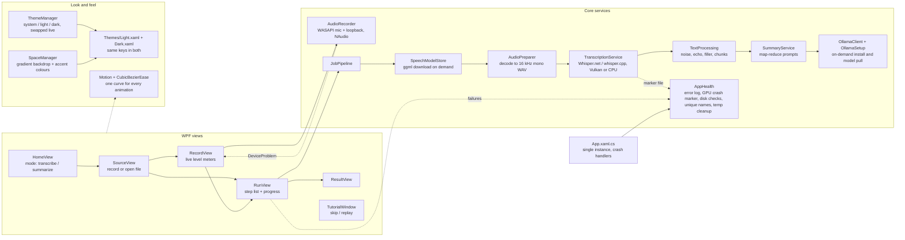

# Meet Simple (C# / .NET 8 / WPF)

Windows desktop app that records a meeting (microphone + computer audio, as separate tracks) or opens an existing
recording, transcribes it locally, and optionally writes a short summary locally. Nothing leaves the computer.

## Architecture



## Folder map
```
/
  README.md, LICENSE, CONTRIBUTING.md, SECURITY.md, AGENTS.md
  MeetSimple.sln, global.json
  .github/                 CI, CodeQL, Dependabot
  src/MeetSimple/          WPF app project (csproj, XAML, Core, Views, Theming, Themes, Fonts)
  build/                   build.bat, Trim-Publish.ps1, installer.iss
  publish/                 local output only (gitignored)
```
- `src/MeetSimple/Core/` - no UI code. `JobPipeline` runs the steps and reports `StepUpdate`s; setup steps (speech model, Ollama, summary AI) run only when the chosen mode needs them.
- `src/MeetSimple/Views/` - one UserControl per screen; `MainWindow` is the shell (custom chrome: sidebar + floating content card) and owns navigation (`Navigate`, `Show*`). `AppDialog` is the themed notice/confirm window.
- `src/MeetSimple/Fonts/` - embedded SF Pro Display OTF cuts (Regular, Medium, Bold), included as WPF `Resource` (`Fonts\*.otf` in the csproj).
- `src/MeetSimple/Theme.xaml` - colours, fonts, button/card styles. Use `AccentButton`, `QuietButton`, `LinkButton`, `DangerButton`, `CardBorder`, `ChoiceCardButton` (keyboard-focusable Home/Source cards), `PanelBorder`, `DisplayTitle` (bold page/card titles).
- `build/build.bat` - self-contained single-file publish to repo-root `publish\` + zip for sharing. Force-closes running `MeetSimple.exe` first; calls `build/Trim-Publish.ps1` to drop unused Whisper RIDs and write `Read me.txt`. `build/installer.iss` - optional Inno Setup installer.

## Behaviour to preserve
- First launch shows `TutorialWindow`; "Skip tour" is always visible; "Quick tour" (sidebar) replays it. `AppSettings.TutorialCompleted` is set when it closes either way.
- Nothing large is downloaded without asking (`MainWindow.ConfirmSetupAsync`). If the summary engine fails to set up, the transcript is still delivered and the failure is shown on the result screen.
- Recorded tracks: "You" (microphone) and "Others" (computer audio). Echoes of "Others" on the mic track are dropped in `TextProcessing.MergeTracks`.
- WASAPI loopback sends no data during silence, so `TrackWriter` pads silence to keep both tracks aligned.

## Conventions
- Meaningful names only (no single-character variables). Long-running work stays off the UI thread; UI updates go through `Dispatcher`.
- Public docs at repo root: `README.md`, `CONTRIBUTING.md`, `SECURITY.md`, and this file.

## Theming and motion
- `Themes/Light.xaml` and `Themes/Dark.xaml` hold only colour brushes and must define identical keys. `ThemeManager` swaps them at runtime (merged dictionary index 0). First launch follows the Windows light/dark setting (`Theme = "system"`), and it updates live if Windows changes while the app is open. Choosing Light/Dark in Settings or the sidebar sun/moon button saves an explicit choice.
- Always reference brushes with `{DynamicResource ...}` (never `StaticResource`), and from code use `SetResourceReference` - otherwise that element will not change when the theme does. Use `AccentTextBrush` for accent-coloured text (readable on dark), `AccentBrush` for fills and borders, `ErrorFillBrush` for red button backgrounds.
- Title bars follow the theme through `ThemeManager.Attach(window, brushKey)` (call it for every new window). Prefer `AppDialog` (themed notice/confirm) for in-app prompts; keep native MessageBox only for unexpected fatal errors in `App.xaml.cs`.
- **Typography:** SF Pro Display only for all UI text. `AppFont` and `AppDisplayFont` both point at `pack://application:,,,/Fonts/#SF Pro Display` in `Theme.xaml`. Windows set `FontFamily="{StaticResource AppFont}"`; page and card titles use `Style="{StaticResource DisplayTitle}"` (same family, Bold). Do not add other typefaces. Icon glyphs stay `Segoe MDL2 Assets` via `GlyphText` / explicit `FontFamily` — that system font is required for the symbol set and is not UI body text.
- **`AppDialog`:** borderless transparent window (`WindowStyle="None"`, `AllowsTransparency="True"`, `Background="Transparent"`) with a rounded `SurfaceBrush` card and soft `DropShadowEffect`. Do not put an opaque `Background` or `WindowChrome` CornerRadius on it — that draws a hard black rectangle around the rounded card. Source: `Views/AppDialog.xaml`.
- Every animation uses `CubicBezierEase` (cubic-bezier 0.65, 0, 0.35, 1: ease in, ease out): in XAML as `{StaticResource StandardEase}`, in code through `Theming/Motion.cs` (`FadeIn`, `RiseIn`, `FadeOut`, `Settle`, `AnimateValue`, `Capture`). Durations are 0.2-0.4 s for hover and press, about 0.4-0.6 s for screens and theme changes. Do not add instant colour or visibility jumps.
- Screen changes and theme changes cross-fade using a picture of the old state (`PageSnapshot`, `ThemeSnapshot` in MainWindow). When Windows animations are off (`Motion.Enabled` is false) everything changes instantly.
- Arc-inspired shell (`MainWindow.xaml`): no standard title bar (`WindowChrome`, 36 px drag strip, custom minimise/maximise/close). A gradient "space" backdrop (`SpaceBackdropBrush`) fills the window; the left sidebar draws straight on it (new-transcript pill, pinned tiles, Library rows, space dots, theme toggle) and all screens live in a rounded floating card on the right. When maximised, `RootGrid.Margin` is set to the resize border so nothing is cut off. No privacy footnote in the rail — trust copy lives on Home. Library nav rows use roomy padding (`SidebarNavButton` / `SidebarButton` `10,11` plus small margins between Home / Settings / Quick tour).
- Wizard screens (Source / Record / Run / Result) show a `FlowStepStrip` (`Summarize · Record` style). Record Back returns to Source for the same mode, not Home.
- Spaces (`Theming/SpaceManager.cs`): violet (default), ocean, forest, sunset, graphite. Each defines light and dark gradient colours plus accent colours. `SpaceManager` writes `SpaceBackdropBrush`, `AccentBrush`, `AccentTextBrush` and `AccentSoftBrush` into `Application.Resources`, which override the palette dictionary, so accents follow the space in both themes. The choice is saved as `AppSettings.Space`; changing it cross-fades through the same snapshot mechanism as the theme. `SpaceChanged` fires after a space swap; sidebar and Settings rebuild space dots on theme/space change so dark-mode swatches stay correct.
- **Do not mutate Freezables after putting them in `Application.Resources`.** On .NET 8 WPF, assigning a brush to Resources freezes it (and its `GradientStop`s). `SpaceManager.Apply` must replace the whole frozen brush each time space or theme changes (`FrozenGradient` / `Frozen`); mutating shared static `GradientStop.Color` throws `InvalidOperationException` ("read-only state") at startup.
- Sidebar styles in `Theme.xaml`: `SidebarButton`, `SidebarNavButton` (RadioButton with selected fill), `SpaceDotButton`, `CaptionButton`/`CloseCaptionButton`, `GlyphText` (Segoe MDL2 Assets icons), `IconBadge`. Sidebar text uses the `Sidebar*Brush` keys because it sits on the backdrop, not on the card. Window content must fit at the 1000 px minimum width (card rows use `WrapPanel`).
- Mode/source pickers use `ChoiceCardButton` (real `Button`, keyboard focusable). Decorative/non-click panels stay `CardBorder` / `PanelBorder`. `LinkButton` shows its text twice for the hover fade, so its content must be plain text. Buttons use an overlay tint and a small press scale instead of swapping brushes, so they stay smooth in both themes.

## Security (read before changing network, process or file code)
- Threat model: local, single-user app. Audio, transcripts and summaries never leave the computer. Only runs with the user's rights (`app.manifest`: asInvoker).
- Network egress is exactly three things, each only after the user agrees in `ConfirmSetupAsync`: speech models from huggingface.co, the Ollama installer from ollama.com (redirects to GitHub), and summary models pulled by the local Ollama server. Ollama calls go to localhost only (`UseProxy=false`).
- `Downloader`: HTTPS only, host allowlist checked on every redirect hop (manual redirects, max 5), size caps, SHA-256 computed while streaming, file moved into place only after `verify` passes.
- Speech models: id must be in `Catalog.SpeechModels`; the download is rejected unless it matches Hugging Face's `X-Linked-Etag` SHA-256 (fail closed).
- Ollama: `AuthenticodeVerifier` must confirm a valid signature by "Ollama Inc." on the installer before it runs and on `ollama.exe` before `serve`. `FindExecutable` never searches PATH.
- Untrusted input: the settings file (size cap + `AppSettings.Sanitize`), model names and language codes (`InputValidation`), output file names (`InputValidation.SafeFileName`), regexes (2 s timeout), error text (`Redaction.Scrub` before display or copy).
- Do not: add telemetry, run a PATH-resolved program, follow redirects automatically, skip the checksum or signature checks, or relax the host allowlists without a reason.
- Supply chain: `packages.lock.json` is committed and CI restores with `--locked-mode` on .NET 8; Dependabot + CodeQL + a vulnerable-package check run in `.github/`. `Microsoft.NET.ILLink.Tasks` 8.0.33 is an explicit PackageReference so locked restore matches both `dotnet build` and single-file `dotnet publish`. Releases: publish the zip's SHA-256 (`build.bat` prints it); code-signing the exe is recommended.
- Unverified: the Authenticode P/Invoke, the Ollama installer flags (`/SP- /VERYSILENT /SUPPRESSMSGBOXES /NORESTART`) and the signer name "Ollama Inc." have not been run on a real machine. If the signer check blocks a genuine install, check the certificate's subject before loosening it.

## Licensing
- This project is MIT (`LICENSE`). Dependencies (NAudio, Whisper.net, Whisper model weights) are believed to be MIT - verify on each package/repo page before a release; re-check when upgrading (e.g. NAudio 3 needs net9.0+).
- Models are downloaded at runtime and never bundled in releases or the installer. The default summary model (`llama3.1:8b`) is under Meta's Community License, which the user accepts when it is pulled; bundling it would make this project a redistributor. Keep `Catalog.SummaryModels` swappable (a permissively licensed model is an option).
- **Fonts:** the app embeds Apple SF Pro Display OTF files under `src/MeetSimple/Fonts/`. Apple's license typically restricts redistribution outside Apple platforms — confirm before a public release zip, or swap to a redistributable face and keep `AppFont` as the single override point.
- Documentation lives at the repo root: `README.md` (public landing page), `CONTRIBUTING.md`, `SECURITY.md`, and this file. App source is under `src/MeetSimple/`. If a third-party notice is added later, list each dependency, its license, and what the app downloads.

## Build and share
- Needs the .NET 8 SDK on the build machine only. `build\build.bat` produces a self-contained folder: users install nothing.
- Prefer the 64-bit SDK (`%ProgramW6432%\dotnet`); a 32-bit `dotnet` earlier on PATH often has no SDK and fails with "No .NET SDKs were found."
- Close or let `build\build.bat` kill a running `MeetSimple.exe` before republishing, or MSB3027 file-lock errors appear.
- Unsigned exes show a Windows SmartScreen warning ("More info" > "Run anyway"). A code-signing certificate removes it.
- **Publish layout:** `PublishSingleFile=true` with `IncludeNativeLibrariesForSelfExtract=false` so managed code is one `MeetSimple.exe`, while Whisper natives stay under `runtimes\` next to the exe (Whisper.net probes that folder). WPF still needs a few `*_cor3.dll` natives beside the exe. `build/Trim-Publish.ps1` drops unused RIDs (keeps `runtimes\win-x64` + `runtimes\vulkan\win-x64`), writes `Read me.txt`, and the zip wraps a single `MeetSimple\` folder so the exe is easy to find.
- `SatelliteResourceLanguages=en` avoids shipping dozens of .NET UI culture folders. Do not set `IncludeNativeLibrariesForSelfExtract=true` for Whisper — it can pull win-x64 natives out of `runtimes\` and break loading.

## Transcription accuracy
- Default speech model is `large-v3-turbo-q5_0` (`Catalog.DefaultSpeechModel`); older saved settings that still say `small` are upgraded once via `AppSettings.SettingsVersion`.
- `TranscriptionService.BuildProcessor` mirrors the faster-whisper CLI: beam search (size 5, patience 1) when `BestAccuracy` is on, temperature fallback (0, +0.2), entropy 2.4 / log-prob -1 / no-speech 0.6 thresholds.
- Whisper.net **1.9.0** quirk: `WithBeamSearchSamplingStrategy()` returns `IWhisperSamplingStrategyBuilder` (only `ParentBuilder`). Cast to `BeamSearchSamplingStrategyBuilder` before `WithBeamSize` / `WithPatience`, or CS1061. Do not call those methods on the interface. Stay on 1.9.0 unless deliberately migrating: 1.9.1 removed that interface and changed the sampling API.
- Optional glossary (`AppSettings.Glossary`, cleaned by `InputValidation.CleanGlossary`, max 400 chars) is passed as the Whisper prompt so names and jargon are spelled correctly.
- Loudness normalization was deliberately not added (Whisper's log-mel features are level-insensitive). Whisper.net 1.9.0 has no VAD builder method (only raw native fields), so VAD is not used.
- The transcript stays verbatim; `TextProcessing.CleanFiller` is applied only to summary input.

## Robustness (`Core/AppHealth.cs` and friends)
- **Error log:** `AppHealth.LogError` appends scrubbed errors to `%LOCALAPPDATA%\MeetSimple\logs\meet-simple.log` (rotates at 512 KB). Wired to the window-thread, background-thread and unobserved-task handlers in `App.xaml.cs` and to failed jobs in `RunView`. The error dialogs tell users where the file is so bug reports can include it.
- **Graphics-card crash fallback:** a native Vulkan crash cannot be caught. `TranscriptionService.TranscribeAsync` writes `gpu-attempt.marker` before transcribing and deletes it in `finally`; `App.OnStartup` treats a surviving marker as a crash, sets `AppSettings.UseGraphicsCard = false` and `MainWindow.OnLoaded` explains it. `MainWindow.OnClosing` clears the marker so a deliberate exit is not mistaken for a crash. `TranscriptionService.ConfigureRuntime` sets `RuntimeOptions.RuntimeLibraryOrder` to CPU-only at startup (Whisper.net loads its native engine once, so a Settings change applies after restart).
- **Recording:** `AudioRecorder` never lets an exception escape the capture threads (`WriteSafely`); a failed track is closed and reported through `DeviceProblem`, and `RecordingStopped` with an exception (device unplugged) is reported the same way. `RecordView` warns when only one input could be opened. `TrackWriter` flushes every 10 s so a crash loses seconds, not the file. Starting a recording needs 2 GB free (`AppHealth.EnsureFreeSpace`); recording folders and result file names never overwrite earlier ones (`UniqueFolder`, `UniqueBaseName`).
- **Downloads:** `Downloader` retries transient failures up to 3 times (5xx/408/429, I/O, timeouts), aborts a connection that is silent for 60 s, and checks free disk space against the advertised size. Retries restart from zero (no resume yet).
- **Other:** single-instance mutex in `App.OnStartup`; settings are saved atomically (temp file + move); orphaned `%TEMP%\MeetSimple\*` folders older than 24 h are removed at startup; `AudioPreparer.OpenReader` turns Media Foundation errors into plain advice (convert to MP3/WAV); `SummaryService` retries transient Ollama connection errors.
- **Not covered yet / ideas:** download resume, unit tests for the pure logic (`TextProcessing`, `InputValidation`, `SummaryService` with its injectable `generate`), recordings beyond ~3 h per track (32-bit float WAV hits the 4 GB limit), crash recovery of an interrupted recording, an in-app "open log folder" button.

## Fixes already landed (do not reintroduce)
- **CS1061 beam search:** cast `WithBeamSearchSamplingStrategy()` to `BeamSearchSamplingStrategyBuilder` in `Core/TranscriptionService.cs` (see Transcription accuracy).
- **Startup crash `InvalidOperationException` read-only Freezable:** `SpaceManager` must replace frozen backdrop/accent brushes in Resources, never mutate static gradient stops after insert (see Theming and motion).
- **Publish MSB3027:** `build\build.bat` kills running `MeetSimple.exe` before `dotnet publish`.
- **`AppDialog` black frame:** keep the dialog `AllowsTransparency` + transparent window background with only the rounded card visible; opaque `Background` / `WindowChrome` CornerRadius brought back the hard black rectangle around the card (see Theming and motion).

## Status / unverified
- Package versions confirmed building: NAudio 2.2.1, Whisper.net 1.9.0 + Runtime + Runtime.Vulkan. `WhisperFactory.FromPath`, `CreateBuilder().WithLanguage(...)`, temperature/threshold/`WithPrompt` builders, and `ProcessAsync(Stream, token)` compile on 1.9.0.
- App has been built and launched past `ThemeManager` / `SpaceManager` init on a real machine after the Freezable fix. Craft pass added: sidebar spacing, removed rail privacy footnote, `ChoiceCardButton`, `FlowStepStrip`, `AppDialog`, Settings scroll + space picker, Run overall progress, tutorial step dots. Typography forced to embedded SF Pro Display; `AppDialog` made transparent to kill the black frame. Full UI pass and end-to-end recording / Vulkan / Ollama silent install still need real-machine verification.
- Robustness additions are statically checked only (syntax parse, name cross-check, no compiler available): `RuntimeOptions.RuntimeLibraryOrder = [RuntimeLibrary.Cpu, RuntimeLibrary.CpuNoAvx]` (Whisper.net 1.9.0 `Whisper.net.LibraryLoader`) and the assumption that NAudio's `WaveFileWriter.Flush()` refreshes the WAV header.
- Not yet verified on a real machine: recording, Vulkan runtime selection, Ollama silent install flags and Authenticode signer name "Ollama Inc." (see Security).
