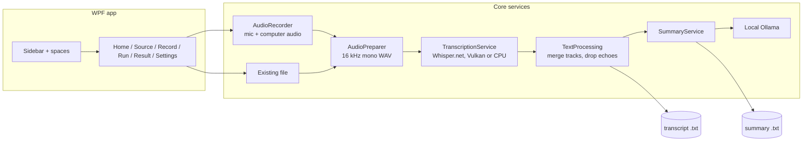

# Meet Simple

Turn meetings and recordings into text, and optionally a short summary, privately on your own Windows PC.
Nothing is uploaded: transcription runs locally with [Whisper](https://github.com/ggerganov/whisper.cpp) and summaries run locally with [Ollama](https://ollama.com).

> **Status:** early release. It builds and the core pipeline is in place, but it has not been tested on many machines yet. Bug reports are welcome.

## Features

- **Record a meeting** - your microphone ("You") and your computer's sound ("Others") are captured as separate tracks, so the transcript shows who said what.
- **Or open a file** - any audio or video recording (MP4, MOV, MKV, MP3, WAV, M4A and more), including very large ones.
- **Two modes** - *Transcribe only* (fast), or *Transcribe + summarize* (filler removed, only the important points, decisions and tasks).
- **Accurate by default** - Whisper large-v3-turbo with beam search, plus an optional list of names and special words to spell correctly.
- **Downloads only what it needs, only after asking** - the speech model, and the summary engine if you choose summaries.
- **Looks at home on Windows** - Arc-inspired layout with colour "spaces", light/dark mode that follows Windows, and smooth ease-in/ease-out animations.
- **Guided tour** on first launch, skippable and replayable any time.

## How it works



## Build from source

Requires Windows 10/11 (x64) and the [.NET 8 SDK or newer](https://dotnet.microsoft.com/download).

```bat
build.bat
```

This publishes a self-contained build to `publish\`, zips it as `MeetSimple-win-x64.zip` and prints the zip's SHA-256. Users of the zip do not need to install anything. For a normal installer, open `installer.iss` in [Inno Setup](https://jrsoftware.org/isdl.php) after running `build.bat`.

Unsigned builds show a Windows SmartScreen warning ("More info" > "Run anyway") until the executable is code-signed.

## Privacy and security

- Audio, transcripts and summaries never leave the computer. There is no telemetry.
- The only network traffic is the one-time downloads you approve: speech models from Hugging Face, the Ollama installer from ollama.com, and summary models pulled by your local Ollama.
- Downloads are HTTPS-only, host-allowlisted, size-capped and checksum-verified; the Ollama installer must carry a valid publisher signature before it runs.
- Please only record calls when everyone on them agrees. Rules differ by country and company.

Dependencies are locked (`packages.lock.json`) and checked in CI with CodeQL, Dependabot and a vulnerable-package scan.

## Contributing

`AGENTS.md` describes the architecture, conventions and the behaviour to preserve. Pull requests and issues are welcome.

## License

[MIT](LICENSE). Speech and summary models are downloaded at runtime and are not part of this repository; each model has its own license.

Built with [Whisper.net](https://github.com/sandrohanea/whisper.net), [whisper.cpp](https://github.com/ggerganov/whisper.cpp), [NAudio](https://github.com/naudio/NAudio) and [Ollama](https://ollama.com).
