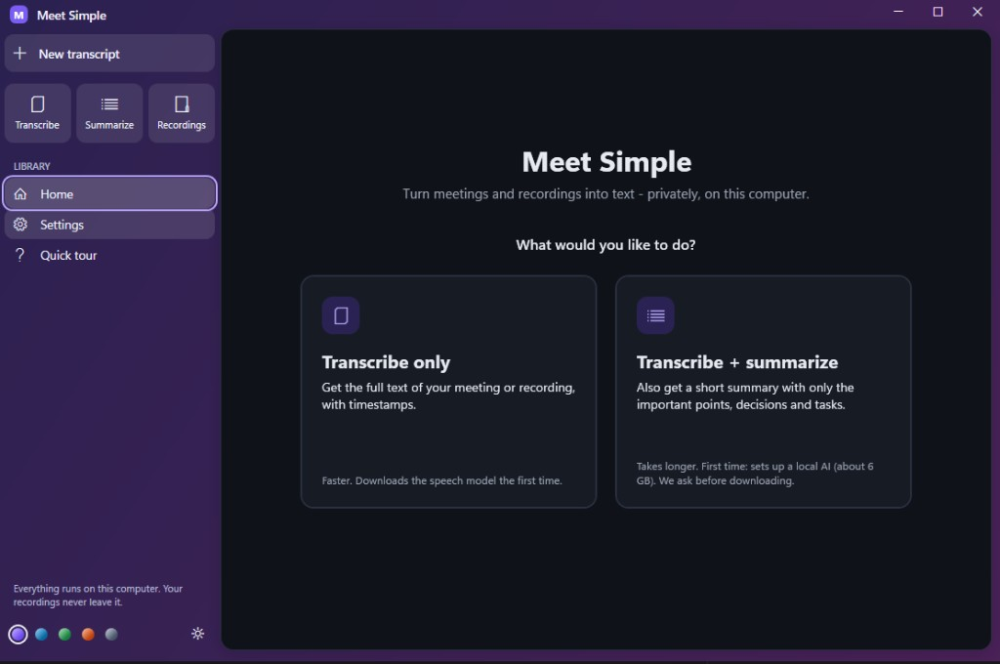
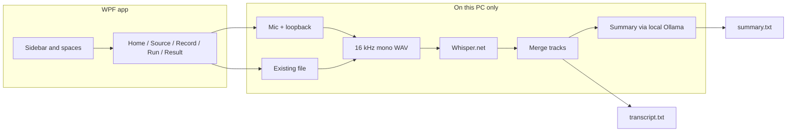

# Meet Simple

**Private meeting transcription and summaries on your Windows PC.**  
Nothing is uploaded. Speech recognition runs locally with [Whisper](https://github.com/ggml-org/whisper.cpp) via [Whisper.net](https://github.com/sandrohanea/whisper.net). Optional summaries run locally with [Ollama](https://ollama.com).

[](https://github.com/devanshhdalal/Meet-Simple/actions/workflows/ci.yml)
[](LICENSE)
[](https://github.com/devanshhdalal/Meet-Simple/releases)
[](https://discord.gg/vf9ruWmd6U)

<p align="center">
  <em>Record a call or open a file → get a transcript (and optionally a short summary) that never leaves your machine.</em>
</p>

<p align="center">
  
</p>

---

## Quick start

1. Download **`MeetSimple-win-x64.zip`** from [Releases](https://github.com/devanshhdalal/Meet-Simple/releases).  
2. Unzip and open the **`MeetSimple`** folder.  
3. Double-click **`MeetSimple.exe`**.

**Transcribe only** works without installing anything else (first run downloads a 574 MB speech model after you agree).  
**Transcribe + summarize** needs a local summary engine: the app can download and run the **[Ollama](https://ollama.com) installer** (a separate third-party product from Ollama Inc.) after you confirm, then pull a summary model through Ollama on localhost. You can also install Ollama yourself first.

Before testing, check [Requirements](#requirements): transcription needs about 8 GB of RAM and a 0.7 GB download; summaries need about 16 GB of RAM and roughly 7 GB of downloads.

Only record calls when everyone involved agrees — laws and policies vary.

---

## Why Meet Simple?

| | |
| --- | --- |
| **Private by design** | Audio, transcripts, and summaries stay on disk. No accounts, no cloud API for speech or summary. |
| **Built for meetings** | Captures mic (“You”) and computer audio (“Others”) as separate tracks, then merges them into one readable transcript. |
| **Honest downloads** | Large models are fetched only after you agree. Checksums and signature checks apply where we can. |
| **Windows-native** | Arc-inspired shell, colour themes, light/dark that can follow Windows, self-contained zip (no .NET install for end users). |

**Why not Otter or Buzz?** Cloud tools like Otter upload your audio. Local apps like [Buzz](https://github.com/chidiwilliams/buzz) are excellent general Whisper UIs — Meet Simple is meeting-focused on Windows: dual-track You/Others capture, optional **local** summary via Ollama, and a desktop flow that asks before multi‑GB downloads.

---

## Features

- **Record a meeting** — microphone + system audio as separate tracks  
- **Open an existing file** — MP4, MOV, MKV, MP3, WAV, M4A, and more  
- **Transcribe only** or **Transcribe + summarize** (filler cleaned for the summary path only; the transcript stays verbatim)  
- **Accurate defaults** — Whisper `large-v3-turbo` with beam search; optional glossary for names and jargon  

<details>
<summary><b>Also included</b></summary>

- **Vulkan or CPU** — uses the GPU when Whisper.net’s Vulkan runtime works; turn on “processor only” in Settings, or the app disables the GPU path after a graphics-card crash marker  
- **First-run tour** — skippable, replayable from the sidebar  
- **Progress pill** — a running job shrinks into a pill at the bottom of the window; click it to jump back  
- **Recording recovery** — if the app closed or crashed mid-meeting, it can offer to transcribe what was already saved (headset unplug / default-device switching are still being hardened)
- **Notices your calls** — when Zoom, Teams, Meet or a similar app starts a call, a small island at the top of the screen asks whether to record; when the call ends, a Windows notification offers Summarize, Transcribe only or Save for now. It never records without your click  
- **Start with Windows** (optional, off by default) — waits quietly in the tray, ready for the next call  

</details>

---

## Requirements

Everything runs on your PC, so your PC does the work. Here is what it needs and what it downloads.

### Your PC

| | Transcribe only | Transcribe + summarize |
| --- | --- | --- |
| **OS** | Windows 10 or 11, x64 | Same |
| **CPU** | x64 with **AVX2, FMA and F16C** (most CPUs from 2015 on) | Same; more cores = faster |
| **RAM** | **8 GB** (the speech model uses about 2–4 GB while transcribing) | **16 GB** for the default Llama 3.1 8B; **8 GB** works with the lighter Llama 3.2 3B (pick it in Settings) |
| **GPU** | Optional. A Vulkan-capable GPU makes transcription much faster | Optional. Ollama uses an NVIDIA or AMD GPU with **6 GB+ VRAM** for the 8B model; without one it runs on the CPU, slower |
| **Free disk** | **About 1 GB**, plus room for recordings | **About 10 GB** (Ollama, the summary model and the speech model) |
| **Internet** | Only for the first-run downloads below | Same |

Transcription and summarizing run one after another, not at the same time. Speed depends heavily on hardware: on a CPU alone, expect transcription to take a good fraction of the meeting's length; a GPU is several times faster. We don't publish reference timings yet. If you time one, please open an issue with your CPU/GPU and numbers.

**Recordings** take about **0.7 GB per hour** (two tracks, You and Others). Recording won't start with less than 2 GB free, and every large download checks free space first.

### What downloads on first run

Nothing downloads until you agree. Each item downloads once and is reused, including across app updates.

| What | When | Size | Stored in |
| --- | --- | --- | --- |
| **Meet Simple** (this zip) | You download it | ~100 MB (~140 MB unzipped) | Wherever you unzip it |
| **Speech model** (Whisper large-v3-turbo, q5_0) | First transcription | **574 MB** | `%LOCALAPPDATA%\MeetSimple\models\` |
| **Voice detector** (Silero VAD) | First transcription | Under 1 MB | Same folder |
| **Ollama installer** | First summary, only if Ollama isn't installed | Roughly **1–1.5 GB** (varies by Ollama release; it bundles GPU runtimes) | Ollama installs into your user profile |
| **Summary model** (Llama 3.1 8B) | First summary | **About 5 GB** (Llama 3.2 3B: about 2 GB) | Ollama's model store (`%USERPROFILE%\.ollama\models`) |

**Totals:** transcribe only is about **0.7 GB** to download. Adding summaries brings it to about **7 GB** downloaded and **10 GB** on disk. After that, Meet Simple works fully offline.

Other speech models can be picked in Settings, from Tiny (75 MB, fastest, least accurate) to Large (3 GB, most accurate, slowest).

### Also needed

| | |
| --- | --- |
| **VC++** | [Visual C++ 2022 x64 Redistributable](https://learn.microsoft.com/en-us/cpp/windows/latest-supported-vc-redist). The zip includes .NET, but Whisper's native libraries may still need this. Most PCs already have it. |
| **Summaries** | [Ollama](https://ollama.com) (a separate third-party product). Meet Simple can install it for you after you agree, or you can install it yourself first. Not needed for transcription only. |

Windows 11 is the most tested. Windows 10 is supported but less exercised; please file an issue if a Windows 10 PC fails. We don't ship the no-AVX Whisper runtime yet, so very old CPUs without AVX2 can't transcribe.

---

## Troubleshooting

- **Keep the folder together** — do not move `MeetSimple.exe` alone; `runtimes\` and the `*_cor3.dll` files next to it are required. See `Read me.txt` in the zip.  
- **SmartScreen** on unsigned builds: **More info → Run anyway**. A code-signed release removes that prompt.  
- **Verify the zip** when a SHA-256 is published with the release:

```bat
certutil -hashfile MeetSimple-win-x64.zip SHA256
```

- If Whisper fails to load with a vague native error, install the **VC++ 2022 x64** redistributable above and retry.

---

## Sample output

Illustrative example (not from a real recorded meeting):

**Transcript (abridged):**

```text
[00:00:12] You: Can we lock the Q2 launch for the 14th?
[00:00:18] Others: Works on our side if docs are ready by Friday.
[00:00:25] You: I'll send the checklist today. Any blockers on API keys?
[00:00:31] Others: None — staging is green.
```

**Summary (abridged):**

```text
- Agreed Q2 launch target: 14th, pending docs by Friday
- Action: send launch checklist today
- Staging/API keys: no blockers
```

---

## Build from source

**Requirements:** Windows 10/11 x64, [.NET 8 SDK](https://dotnet.microsoft.com/download/dotnet/8.0) (SDK, not only the runtime). Prefer the 64-bit SDK under `%ProgramW6432%\dotnet`.

```bat
build\build.bat
```

That script:

1. Publishes a **self-contained, single-file** win-x64 app to `publish\` at the repo root  
2. Trims unused Whisper runtime RIDs (keeps `win-x64` + Vulkan `win-x64`)  
3. Writes `publish\Read me.txt`  
4. Zips a clean `MeetSimple\` folder as `MeetSimple-win-x64.zip` and prints its SHA-256  

Optional installer: after `build\build.bat`, compile [`build/installer.iss`](build/installer.iss) with [Inno Setup](https://jrsoftware.org/isdl.php).

```bat
dotnet build MeetSimple.sln -c Release
```

works for day-to-day compile checks; use `build\build.bat` for something you can share.

### Repository layout

| Path | Purpose |
| --- | --- |
| `src/MeetSimple/` | WPF app (code, XAML, NuGet lockfile, fonts) |
| `docs/` | Screenshots and other media for this README |
| `build/` | Publish script, trim helper, Inno Setup script |
| `.github/` | CI, CodeQL, Dependabot |
| `README.md` / `AGENTS.md` / … | Docs at the root for GitHub |

---

## How it works

Everything below runs on your PC. Summarize steps are skipped in transcribe-only mode.



Architecture notes for contributors live in [`AGENTS.md`](AGENTS.md).

---

## Privacy and security

- No telemetry. Processing is local.  
- Network use is limited to **user-approved** setup: speech models (Hugging Face), the Ollama installer (ollama.com → GitHub), summary model pulls through **localhost** Ollama, and — when Check for updates is on — GitHub release metadata plus a verified zip apply after you click Update.  
- Downloads are HTTPS-only, host-allowlisted, size-capped, and checksum-verified; the Ollama installer must pass an Authenticode check for “Ollama Inc.” before it runs; app updates fail closed without a matching SHA-256.  
- Supply chain: locked `packages.lock.json`, CI `--locked-mode`, CodeQL, and Dependabot. See [`SECURITY.md`](SECURITY.md) to report issues.

---

## Community

Questions, ideas, and feedback are welcome in the [Meet Simple Discord](https://discord.gg/vf9ruWmd6U).

For bugs and concrete change proposals, prefer [GitHub Issues](https://github.com/devanshhdalal/Meet-Simple/issues) or a pull request so the discussion stays searchable with the code. Please do not report security vulnerabilities on Discord — see [`SECURITY.md`](SECURITY.md).

---

## Contributing

Issues and pull requests are welcome. Please read [`CONTRIBUTING.md`](CONTRIBUTING.md) and [`AGENTS.md`](AGENTS.md) (architecture, UI conventions, and behaviour that should not regress).

Suggested workflow:

1. Fork and create a branch  
2. Keep changes focused; match existing naming and theming rules  
3. `dotnet build MeetSimple.sln -c Release` (and `build\build.bat` if you touch publish)  
4. Open a PR with a short summary and test notes  

---

## License

[MIT](LICENSE) © 2026 Devansh.

The UI font is [Inter](https://rsms.me/inter/) by Rasmus Andersson, under the SIL Open Font License 1.1 (`src/MeetSimple/Fonts/OFL.txt`, shipped as `Licenses/Inter-OFL.txt`).

Speech and summary **models are not shipped** in this repository; they are downloaded at runtime and carry their own licenses. The default summary model (`llama3.1:8b`) is under Meta’s [**Llama 3.1 Community License**](https://www.llama.com/llama3_1/license/). Built with [Whisper.net](https://github.com/sandrohanea/whisper.net), [whisper.cpp](https://github.com/ggml-org/whisper.cpp), [NAudio](https://github.com/naudio/NAudio), and [Ollama](https://ollama.com).

---

## Status

Early open-source release ([v0.1.3](https://github.com/devanshhdalal/Meet-Simple/releases/tag/v0.1.3)). Bug reports and timed hardware notes are welcome.

**Verified**
- App launches on Windows 11 x64; self-contained zip layout (`MeetSimple.exe` + `runtimes\`)
- Transcribe-only path does not require Ollama
- Speech models cache under AppData and are reused across app updates
- Call detection prompts when a meeting app holds the mic; never records without a click; tray + optional Start with Windows
- Background jobs keep running behind Home/Settings via the activity island
- UI uses embedded Inter (Inter Display for titles); light/dark and colour spaces swap live
- Optional in-app update check (Settings) compares this build to GitHub releases and applies only after SHA-256 verification

**Known limitations**
- Live recording edge cases (headset unplug, default-device switch) still being hardened
- Vulkan / GPU path not exhaustively tested across hardware
- Ollama silent install + Authenticode checks need more real-machine confirmation
- In-app Update → apply needs a published `MeetSimple-win-x64.zip` + `.sha256` on the GitHub release to be exercised end-to-end
- Default Whisper CPU runtime expects **AVX2** (NoAvx runtime not shipped yet)
- Windows 10 support intended but less exercised than Windows 11
- No published reference timings yet for “N-minute meeting → X minutes” on CPU vs GPU
