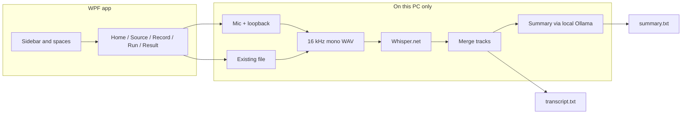

# Meet Simple

**Private meeting transcription and summaries on your Windows PC.**  
Nothing is uploaded. Speech recognition runs locally with [Whisper](https://github.com/ggerganov/whisper.cpp) via [Whisper.net](https://github.com/sandrohanea/whisper.net). Optional summaries run locally with [Ollama](https://ollama.com).

[](https://github.com/devanshhdalal/Meet-Simple/actions/workflows/ci.yml)
[](LICENSE)

<p align="center">
  <em>Record a call or open a file → get a transcript (and optionally a short summary) that never leaves your machine.</em>
</p>

---

## Why Meet Simple?

| | |
| --- | --- |
| **Private by design** | Audio, transcripts, and summaries stay on disk. No accounts, no cloud API for speech or summary. |
| **Built for meetings** | Captures mic (“You”) and computer audio (“Others”) as separate tracks, then merges them into one readable transcript. |
| **Honest downloads** | Large models are fetched only after you agree. Checksums and signature checks apply where we can. |
| **Windows-native** | colour “spaces”, light/dark that can follow Windows, self-contained zip (no .NET install for end users). |

---

## Features

- **Record a meeting** — microphone + system audio as separate tracks  
- **Open an existing file** — MP4, MOV, MKV, MP3, WAV, M4A, and more  
- **Transcribe only** or **Transcribe + summarize** (filler cleaned for the summary path only)  
- **Accurate defaults** — Whisper `large-v3-turbo` with beam search; optional glossary for names and jargon  
- **Vulkan or CPU** — uses GPU when Whisper.net’s Vulkan runtime is available  
- **First-run tour** — skippable, replayable from the sidebar  
- **Keeps working while you look around** — a running job shrinks into a progress pill at the bottom of the window; click it to jump back  
- **Never loses a recording** — closed or crashed mid-meeting? It offers to transcribe what was saved next time  

---

## Quick start (end users)

1. Download **`MeetSimple-win-x64.zip`** from [Releases](https://github.com/devanshhdalal/Meet-Simple/releases) (or build it yourself below).  
2. Unzip — you get a **`MeetSimple`** folder.  
3. Open that folder and double-click **`MeetSimple.exe`**.  
4. Keep the other files next to the exe (they are required support libraries). See `Read me.txt` in the folder.

Unsigned builds may show a Windows SmartScreen warning: **More info → Run anyway**. A code-signed release removes that prompt.

Verify the zip when a SHA-256 is published next to the download:

```bat
certutil -hashfile MeetSimple-win-x64.zip SHA256
```

---

## Build from source

**Requirements:** Windows 10/11 x64, [.NET 8 SDK](https://dotnet.microsoft.com/download/dotnet/8.0) (SDK, not only the runtime).

```bat
build\build.bat
```

That script:

1. Publishes a **self-contained, single-file** win-x64 app to `publish\` at the repo root  
2. Trims unused Whisper runtime RIDs (keeps `win-x64` + Vulkan `win-x64`)  
3. Writes `publish\Read me.txt`  
4. Zips a clean `MeetSimple\` folder as `MeetSimple-win-x64.zip` and prints its SHA-256  

Optional installer: after `build\build.bat`, compile [`build/installer.iss`](build/installer.iss) with [Inno Setup](https://jrsoftware.org/isdl.php).

```bat
dotnet build MeetSimple.sln -c Release
```

works for day-to-day compile checks; use `build\build.bat` for something you can share.

### Repository layout

| Path | Purpose |
| --- | --- |
| `src/MeetSimple/` | WPF app (code, XAML, NuGet lockfile) |
| `build/` | Publish script, trim helper, Inno Setup script |
| `.github/` | CI, CodeQL, Dependabot |
| `README.md` / `AGENTS.md` / … | Docs at the root for GitHub |

---

## How it works



Architecture notes for contributors live in [`AGENTS.md`](AGENTS.md).

---

## Privacy and security

- No telemetry. Processing is local.  
- Network use is limited to **user-approved** setup: speech models (Hugging Face), the Ollama installer (ollama.com → GitHub), and summary model pulls through **localhost** Ollama.  
- Downloads are HTTPS-only, host-allowlisted, size-capped, and checksum-verified; the Ollama installer must pass an Authenticode check for “Ollama Inc.” before it runs.  
- Only record calls when everyone involved agrees — laws and policies vary.

Dependency versions are locked (`packages.lock.json`). CI restores with `--locked-mode` and runs CodeQL, Dependabot, and a vulnerable-package check. See [`SECURITY.md`](SECURITY.md) to report issues.

---

## Contributing

Issues and pull requests are welcome. Please read [`CONTRIBUTING.md`](CONTRIBUTING.md) and [`AGENTS.md`](AGENTS.md) (architecture, UI conventions, and behaviour that should not regress).

Suggested workflow:

1. Fork and create a branch  
2. Keep changes focused; match existing naming and theming rules  
3. `dotnet build MeetSimple.sln -c Release` (and `build\build.bat` if you touch publish)  
4. Open a PR with a short summary and test notes  

---

## License

[MIT](LICENSE) © 2026 Devansh.

The UI font is [Inter](https://rsms.me/inter/) by Rasmus Andersson, under the SIL Open Font License 1.1 (`src/MeetSimple/Fonts/OFL.txt`, shipped as `Licenses/Inter-OFL.txt`).

Speech and summary **models are not shipped** in this repository; they are downloaded at runtime and carry their own licenses (e.g. Meta’s Community License for the default summary model). Built with [Whisper.net](https://github.com/sandrohanea/whisper.net), [whisper.cpp](https://github.com/ggerganov/whisper.cpp), [NAudio](https://github.com/naudio/NAudio), and [Ollama](https://ollama.com).

---

## Status

Early open-source release. The app builds and the core pipeline runs on real machines for shell/startup paths; broader testing (recording, Vulkan, Ollama silent install) is still ongoing. Bug reports and fixes help a lot.
